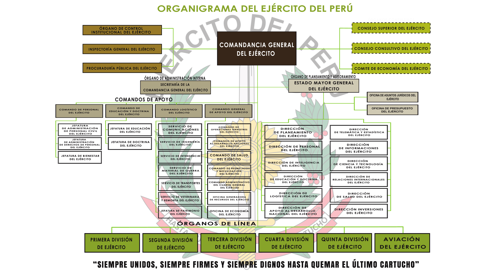
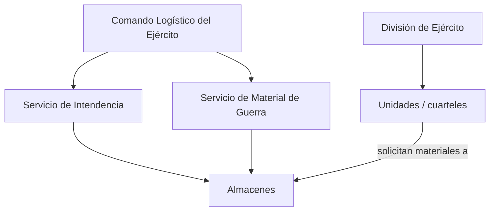

# Contexto organizacional

El SGA está pensado para la gestión de los almacenes del **Ejército del Perú**. Este documento muestra su estructura orgánica e identifica los órganos relacionados con el sistema.

## Organigrama del Ejército del Perú

> Fuente: Organigrama del Ejército del Perú, 2021.

## Problemática documentada

Estudios de las propias escuelas del Ejército confirman el problema que aborda el SGA:

- En el Comando Logístico del Ejército "se sigue dependiendo del papel para poder trabajar", "todavía existen demasiados trámites innecesarios" y "no existe un sistema único para manejar los inventarios", lo que impide saber en tiempo real dónde están los bienes ([Escuela Militar de Chorrillos](https://repositorio.escuelamilitar.edu.pe/items/f7b40a4e-d1d7-428e-8e36-a3e25b0fc0f8)).
- En el Servicio de Intendencia no se generan "datos administrativos integrados, exactos, oportunos y accesibles" ([Escuela Superior de Guerra del Ejército](https://repositorio.esge.edu.pe/server/api/core/bitstreams/2754d318-7eed-40b8-be1d-f7bc1ce6778b/content)).

## Órganos relacionados con el sistema

### Relación directa

| Órgano | Ubicación en el organigrama | Función relacionada | Participación en el SGA |
|---|---|---|---|
| **Comando Logístico del Ejército (COLOGE)** | Comandos de apoyo | Ejecuta los procedimientos técnicos y normativos del sistema logístico y el control patrimonial | Órgano responsable del sistema; autoriza el material controlado |
| **Servicio de Intendencia (SINTE)** | Comando Logístico | Abastecimiento y mantenimiento de intendencia (víveres, vestuario y equipo) | Administra los almacenes que abastecen a las unidades |
| **Servicio de Material de Guerra** | Comando Logístico | Material de guerra | Material controlado, que requiere autorización superior |
| **Servicio de Transportes** | Comando Logístico | Transporte | Despacho y traslado de los materiales |
| **Jefatura de Patrimonio** | Comando Logístico | Control patrimonial | Ajustes de inventario |
| **Divisiones de Ejército (I a V) y Aviación del Ejército** | Órganos de línea | Unidades operativas | Unidades que solicitan materiales |

### Relación indirecta

| Órgano | Participación en el SGA |
|---|---|
| **Inspectoría General del Ejército** y **Órgano de Control Institucional** | Verificación de la auditoría y de los documentos firmados |
| **Dirección de Logística del Ejército** | Definición de las normas y reglas de aprobación |
| **Dirección de Telemática y Estadística** | Administración técnica del sistema |

### Fuera del alcance

Las **Oficinas de Presupuesto y de Economía** se relacionan con la logística, pero el SGA no gestiona compras, presupuesto ni pagos.

## Cómo se representan los órganos en el sistema

Los órganos **no son actores**: los actores son las personas que trabajan en ellos según su rol. El sistema registra la estructura orgánica como datos, para saber a qué órgano pertenece cada usuario, cada almacén y cada unidad.

