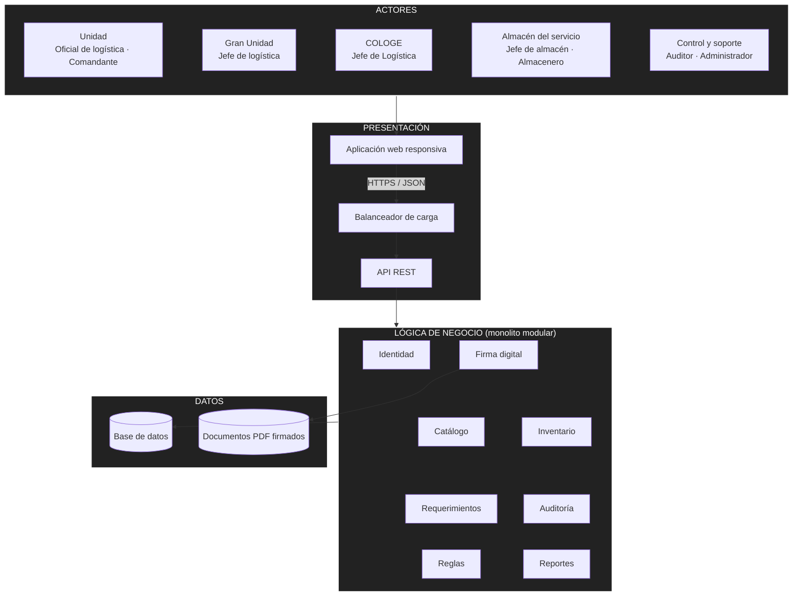

# Arquitectura inicial del sistema

## Diagrama de arquitectura

## Descripción

| Capa | Elementos | Responsabilidad |
|---|---|---|
| **Actores** | Usuarios de la unidad, la gran unidad, el COLOGE, el almacén del servicio, la Inspectoría General y la Dirección de Telemática | Usan el sistema desde el navegador de una computadora o un celular, según su rol y su órgano. |
| **Presentación** | Aplicación web, balanceador de carga y API REST | Muestran las pantallas, reparten las peticiones entre las instancias de la API y validan los datos de entrada. |
| **Lógica de negocio** | Ocho módulos | Aplican las reglas del negocio: conducto regular, firma digital, inventario, alertas y auditoría. |
| **Datos** | Base de datos y documentos firmados | Guardan la información del sistema y los PDF firmados, que no se modifican. |

## Componentes por capa

| Capa | Componentes | Tecnología |
|---|---|---|
| Presentación | Aplicación web responsiva | React + TypeScript |
| Presentación | Balanceador de carga | Nginx |
| Presentación | API REST | Python + FastAPI |
| Lógica de negocio | Identidad, Catálogo, Requerimientos, Reglas, Firma digital, Inventario, Auditoría y Reportes | Python + FastAPI (monolito modular) |
| Datos | Base de datos | PostgreSQL |
| Datos | Documentos PDF firmados | Disco local del servidor |
| Infraestructura | Contenedores y reinicio automático | Docker Compose |

> En esta versión el sistema no se integra con sistemas externos; el SIGA MEF queda fuera del alcance (RC12). El módulo de Mensajería se incorporará en la fase 2.