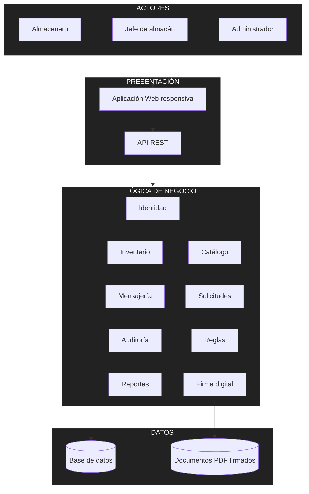

# Arquitectura inicial del sistema

## Diagrama de arquitectura

## Descripción

| Capa | Elementos | Responsabilidad |
|---|---|---|
| **Actores** | Almacenero, jefe de almacén, administrador | Usan el sistema desde el navegador de una computadora o un celular. |
| **Presentación** | Aplicación web y API REST | Muestran las pantallas, reciben las peticiones y validan los datos de entrada. |
| **Lógica de negocio** | Nueve módulos | Aplican las reglas del negocio: aprobación, firma, inventario, alertas, prioridad y auditoría. |
| **Datos** | Base de datos y documentos firmados | Guardan la información del sistema y los PDF firmados, que no se modifican. |

> El proveedor externo solo se registra como origen de un pedido.