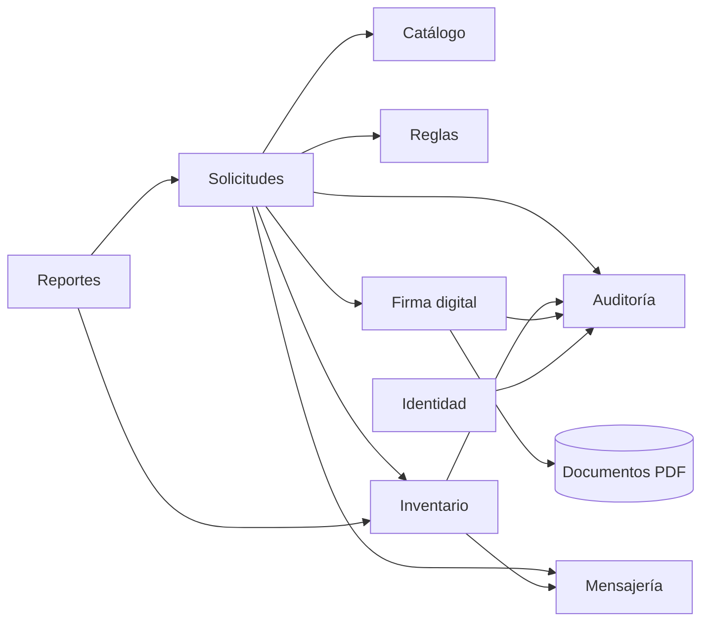

# Componentes arquitectónicos

| Componente (módulo) | Responsabilidad | Requisitos funcionales |
|---|---|---|
| **Identidad** | Inicio de sesión, roles y acceso según el almacén del usuario. | RF01 |
| **Catálogo** | Gestión de almacenes, ítems y usuarios. | RF13 |
| **Solicitudes** | Registro de solicitudes, estados, seguimiento, despacho, recepción y prioridad. | RF02, RF05, RF06, RF07, RF11 |
| **Reglas** | Decidir si una solicitud se aprueba automáticamente o requiere firma, y administrar las reglas. | RF03, RF13 |
| **Firma digital** | Calcular la huella del documento, firmarlo, generar el PDF y verificarlo. | RF04, RF06, RF14 |
| **Inventario** | Stock, registro de movimientos, umbrales, alertas y sugerencias de reposición. | RF08, RF09, RF10 |
| **Mensajería** | Mensajes dentro de cada solicitud y notificaciones a los usuarios. | RF12 |
| **Auditoría** | Registro encadenado de las operaciones importantes y su verificación. | RF14 |
| **Reportes** | Panel de control y reportes exportables en CSV. | RF15 |

## Relaciones principales entre módulos

> Las flechas significan "usa el servicio de". **Solicitudes** es el módulo central: coordina las reglas, la firma, el inventario, los mensajes y la auditoría.