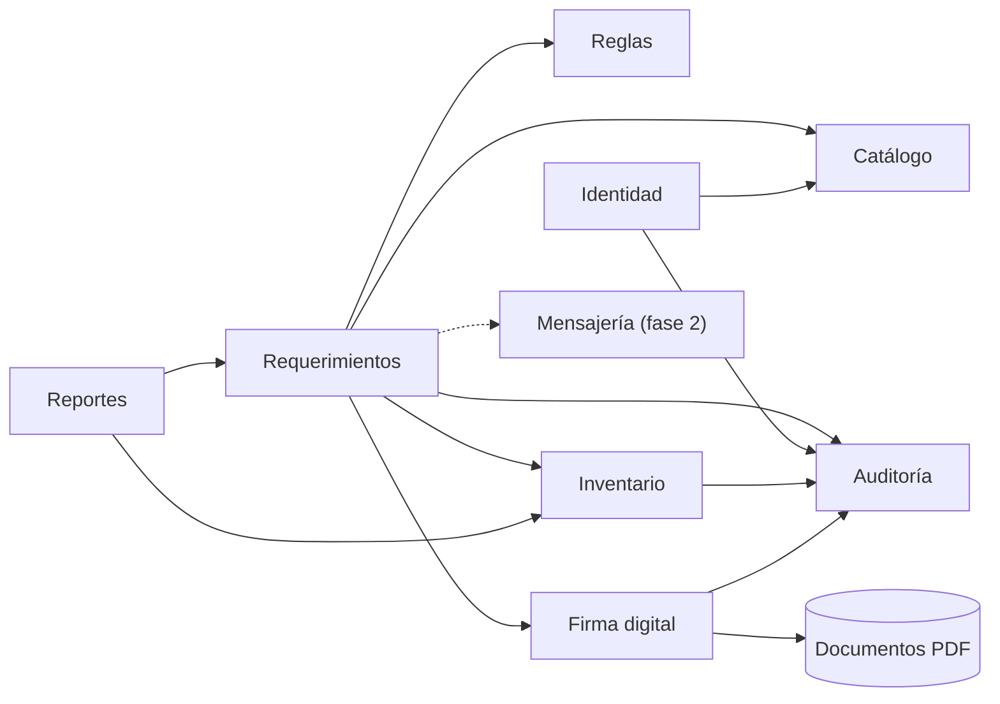

# Componentes arquitectónicos

| Componente | Tipo | Responsabilidad | Requisitos funcionales | Alcance |
|---|---|---|---|---|
| **Identidad** | Módulo | Inicio de sesión, roles y acceso según el órgano del usuario. | RF01 | Prototipo |
| **Catálogo** | Módulo | Gestión de órganos, unidades, almacenes, ítems y usuarios, con su jerarquía. | RF10 | Prototipo |
| **Requerimientos** | Módulo | Registro de requerimientos, conducto regular, rechazos, recepción y línea de tiempo. | RF02, RF03, RF07, RF08 | Prototipo |
| **Reglas** | Módulo | Decidir si un requerimiento necesita la autorización del COLOGE y si se aprueba automáticamente en el almacén. | RF04 | Prototipo |
| **Firma digital** | Módulo | Calcular la huella del documento, firmarlo en cada nivel, generar el PDF y verificarlo. | RF05 | Prototipo |
| **Inventario** | Módulo | Stock, registro de movimientos, despachos, salidas y alertas de stock bajo. | RF06, RF09 | Prototipo |
| **Auditoría** | Módulo | Registro encadenado de las operaciones importantes, su verificación y la consulta del auditor. | RF11 | Prototipo |
| **Reportes** | Módulo | Panel de control con el estado de los requerimientos y del stock. | RF12 | Prototipo |
| **Mensajería** | Módulo | Mensajes dentro de cada requerimiento y notificaciones. | — | Fase 2 |
| **Nginx** | Infraestructura | Repartir las peticiones entre las instancias de la API. | — | Prototipo |
| **PostgreSQL** | Infraestructura | Guardar la información del sistema. | — | Prototipo |
| **Almacenamiento de documentos** | Infraestructura | Guardar los PDF firmados en el disco local. | — | Prototipo |

## Relaciones principales entre módulos

> Las flechas significan "usa el servicio de". **Requerimientos** es el módulo central: coordina las reglas, la firma, el inventario y la auditoría. La línea punteada indica un módulo de la fase 2.