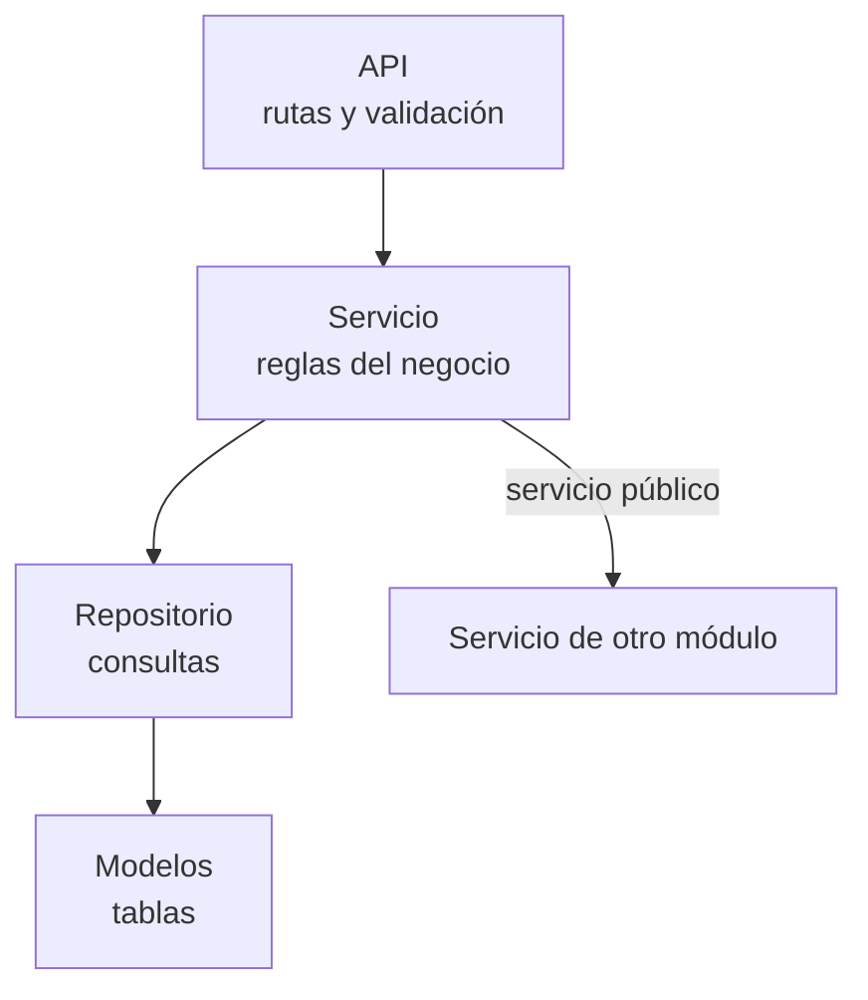

# Enfoque arquitectónico

Se utiliza el enfoque de **arquitectura en capas dentro de cada módulo**, para separar la recepción de peticiones, las reglas del negocio y el acceso a los datos.

| Elemento | Descripción aplicada al SGA |
|---|---|
| Patrón / enfoque arquitectónico | Arquitectura en capas por módulo. |
| Objetivo | Que las reglas del negocio estén en un solo lugar y no se mezclen con la tecnología web ni con las consultas a la base de datos. |
| ¿Qué problema resuelve? | Evita que la lógica quede repartida en las rutas de la API, facilita probar las reglas (aprobación, prioridad, firma) y evita que un módulo dependa de los datos internos de otro. |
| Capas definidas | **API** (rutas y validación), **Servicio** (reglas del negocio y transacciones), **Repositorio** (consultas a la base de datos) y **Modelos** (estructura de las tablas). |
| Beneficios | • Cada capa tiene una sola responsabilidad. • Las reglas del negocio se pueden probar sin levantar el servidor. • Cambiar la base de datos o el almacenamiento de documentos no obliga a modificar las reglas. |

## Dirección de las dependencias

Cada capa solo conoce a la capa de abajo. Cuando un módulo necesita algo de otro, lo pide a través del **servicio** de ese módulo, nunca directamente a sus datos.