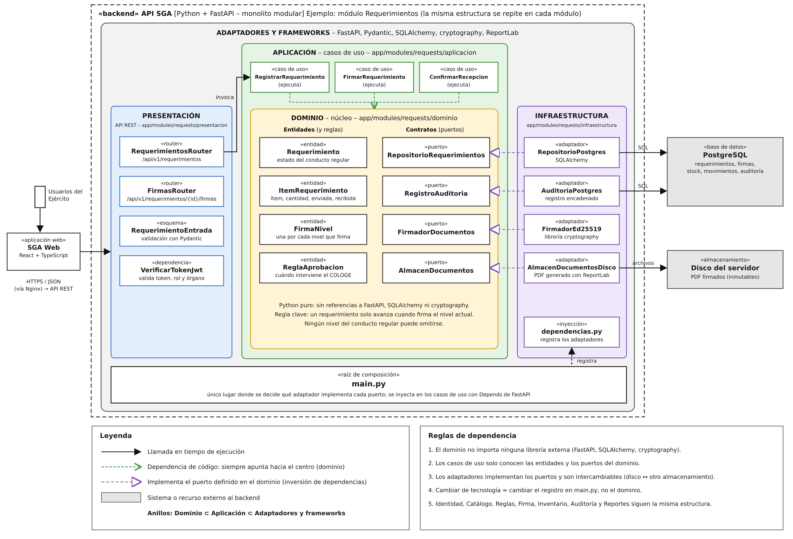
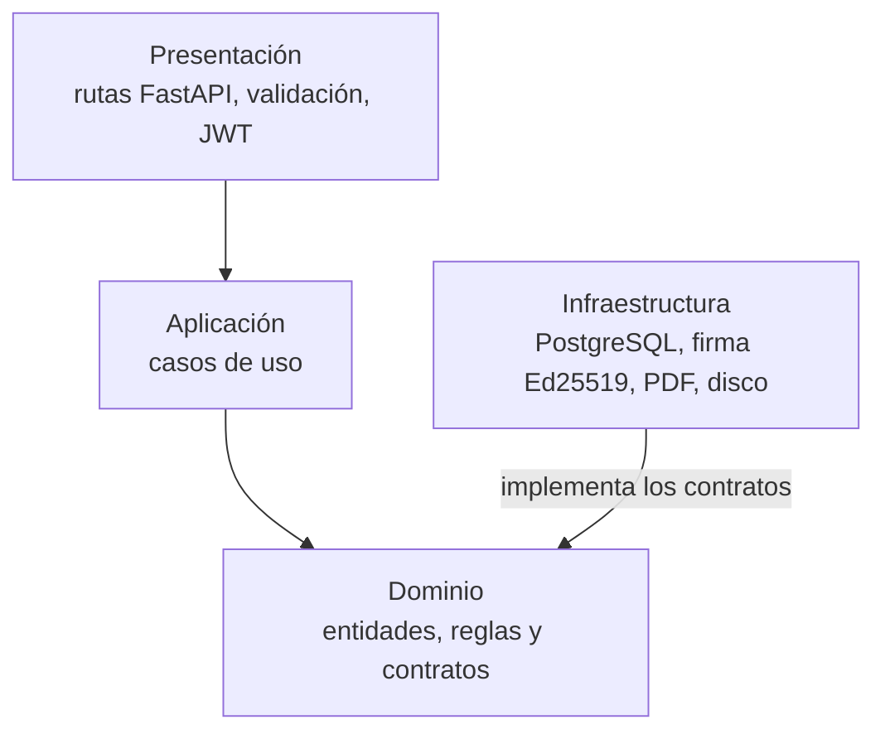

# Enfoque arquitectónico

Se utiliza el enfoque **Clean Architecture (Arquitectura Limpia)** dentro de cada módulo del monolito modular (ADR-002), para separar las reglas del negocio de los detalles tecnológicos.

| Elemento | Descripción aplicada al SGA |
|---|---|
| Patrón / enfoque arquitectónico | Clean Architecture (Arquitectura Limpia). |
| Objetivo | Separar responsabilidades y hacer que todas las dependencias apunten hacia el dominio, donde están las reglas del negocio. |
| ¿Qué problema resuelve? | Evita que las reglas del conducto regular, de la firma digital y del inventario dependan de FastAPI, de PostgreSQL o de la librería de firma. Así se pueden probar sin base de datos y cambiar la tecnología sin modificarlas. |
| Capas definidas | **Dominio**: entidades (requerimiento, firma, stock, movimiento), reglas del negocio (estados del conducto regular y reglas de aprobación) y contratos (interfaces). **Aplicación**: casos de uso (registrar, firmar, despachar y confirmar la recepción de un requerimiento). **Infraestructura**: implementaciones de los contratos (repositorios con PostgreSQL, firma con la librería `cryptography`, generación del PDF y almacenamiento en disco). **Presentación**: API REST con FastAPI (rutas, validación de datos y verificación del token JWT). |
| Beneficios | • Las reglas del negocio se prueban con pruebas unitarias, sin base de datos ni servidor. • Cambiar el almacenamiento de los PDF o la forma de firmar solo afecta a la infraestructura. • Cada capa tiene una sola responsabilidad y todos los módulos siguen la misma estructura. |

## Diagrama de Clean Architecture

## Regla de dependencia

Las flechas indican de qué depende cada capa: **todas apuntan hacia el dominio**. El dominio no conoce FastAPI, PostgreSQL ni ninguna librería externa; solo define los contratos que la infraestructura implementa.

## Clean Architecture dentro del monolito modular

| Nivel | Qué organiza | Decisión |
|---|---|---|
| **Estilo** | El sistema completo: una aplicación con ocho módulos | Monolito modular (ADR-001) |
| **Enfoque** | Cada módulo por dentro: dominio, aplicación, infraestructura y presentación | Clean Architecture (ADR-002) |