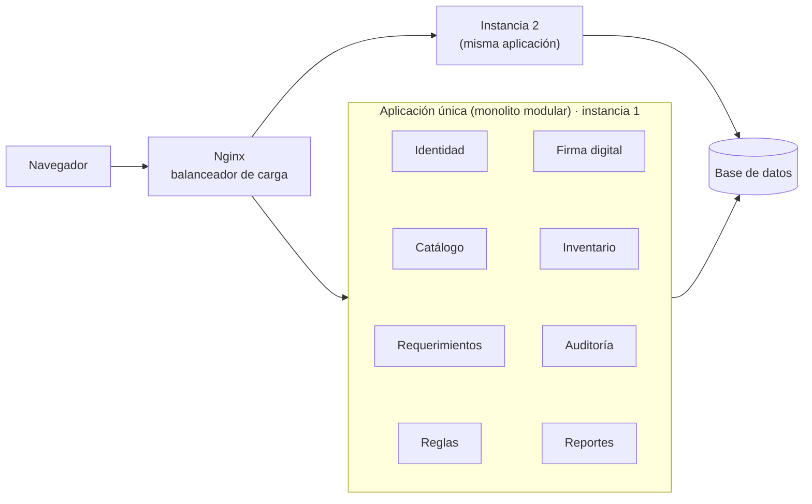

# Estilo arquitectónico

Se utiliza el estilo arquitectónico: **monolito modular + capas**.

| Elemento | Descripción aplicada al SGA |
|---|---|
| Estilo | Monolito modular: una sola aplicación desplegable, dividida en ocho módulos con responsabilidades claras. |
| ¿Por qué? | El sistema lo construye una sola persona; un único despliegue es más fácil de desarrollar, probar y ejecutar con Docker Compose (ADR-001). |
| Regla principal | Un módulo no accede directamente a los datos de otro; se comunica a través de los servicios que ese módulo ofrece. |
| Escalamiento | Se pueden levantar varias instancias de la misma aplicación detrás de Nginx, porque la API no guarda estado de sesión (ADR-006 y ADR-012). |
| Alternativa descartada | Microservicios: requieren varios despliegues, comunicación por red entre servicios y transacciones distribuidas, lo que dificultaría mantener consistente el inventario. |
| Evolución posible | Como cada módulo tiene límites claros, en el futuro podría separarse si el sistema crece. |

