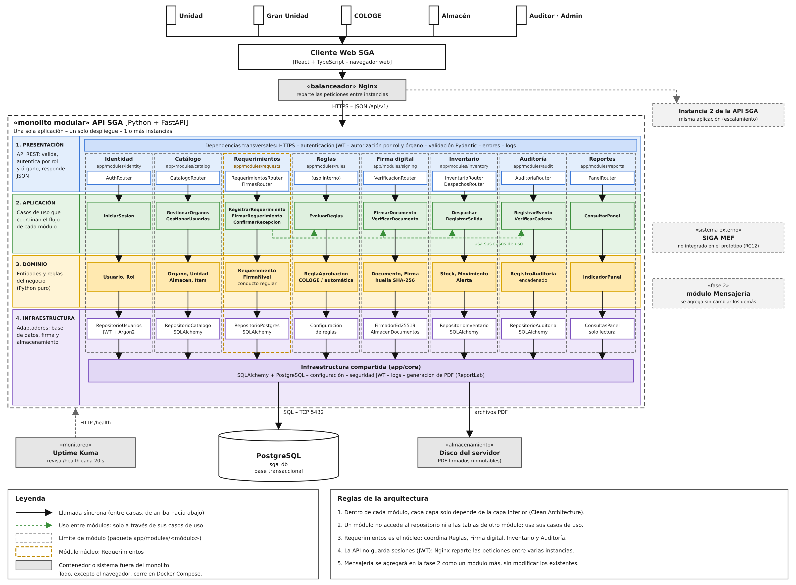

# Estilo arquitectónico

Se utiliza el estilo arquitectónico: **monolito modular + capas**.

| Elemento | Descripción aplicada al SGA |
|---|---|
| Estilo | Monolito modular: una sola aplicación desplegable, dividida en ocho módulos con responsabilidades claras. |
| ¿Por qué? | El sistema lo construye una sola persona; un único despliegue es más fácil de desarrollar, probar y ejecutar con Docker Compose (ADR-001). |
| Capas por módulo | Presentación (API REST), Aplicación (casos de uso), Dominio (entidades y reglas) e Infraestructura (adaptadores), según el enfoque Clean Architecture (ADR-002). |
| Regla principal | Un módulo no accede directamente a los datos de otro; se comunica a través de sus casos de uso. |
| Escalamiento | Se pueden levantar varias instancias de la misma aplicación detrás de Nginx, porque la API no guarda estado de sesión (ADR-006 y ADR-012). |
| Componentes fuera del monolito | Aplicación web (React), balanceador de carga (Nginx), base de datos (PostgreSQL), almacenamiento de los PDF firmados y monitoreo (Uptime Kuma). |
| Alternativa descartada | Microservicios: requieren varios despliegues, comunicación por red entre servicios y transacciones distribuidas, lo que dificultaría mantener consistente el inventario. |
| Evolución posible | Como cada módulo tiene límites claros, en el futuro podría separarse si el sistema crece; el módulo Mensajería se agregará en la fase 2. |

> Archivo editable: `img/fuentes-svg/monolito-modular-sga.svg`