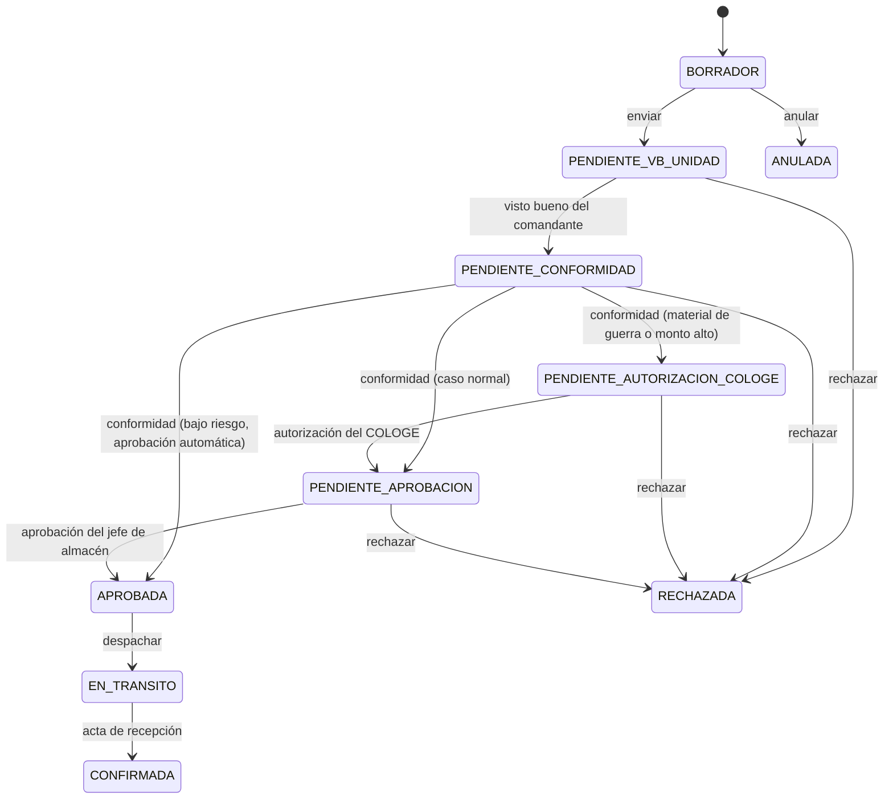

# Diseño interno de módulos

> **Proyecto:** SGA · **Backend:** Python + FastAPI · **Módulo de referencia:** Requerimientos
> **Enfoque arquitectónico:** Clean Architecture dentro de cada módulo del monolito modular
> **Nivel C4:** 4 – Código · **Versión:** 2.0

---

## 1. Propósito

Este documento describe **cómo se organiza el código dentro de un módulo** del backend. Tiene tres objetivos:

- que los ocho módulos se construyan con la misma estructura;
- que las reglas del negocio queden en el dominio, sin depender de FastAPI ni de PostgreSQL;
- que se sepa dónde va cada archivo y de qué puede depender.

Los nombres de carpetas y archivos del código se escriben en español sin tildes; las librerías externas conservan sus nombres originales.

## 2. Estructura de carpetas

```text
backend/app/
├── main.py                              Raíz de composición: crea la aplicación y registra los módulos
├── core/                                Configuración, conexión a la base de datos y seguridad (JWT)
└── modules/
    └── requests/                        Módulo Requerimientos
        ├── dominio/
        │   ├── requerimiento.py         Entidad Requerimiento y sus transiciones de estado
        │   ├── estado.py                Enumeración EstadoRequerimiento
        │   ├── firma_nivel.py           Objeto de valor FirmaNivel
        │   ├── regla_aprobacion.py      Regla: cuándo interviene el COLOGE
        │   └── puertos.py               Contratos: repositorio, firmador, almacén de documentos y auditoría
        ├── aplicacion/
        │   ├── registrar_requerimiento.py
        │   ├── firmar_requerimiento.py
        │   └── confirmar_recepcion.py
        ├── infraestructura/
        │   ├── modelos.py               Tablas con SQLAlchemy
        │   ├── repositorio_postgres.py  Implementa RepositorioRequerimientos
        │   ├── firmador_ed25519.py      Implementa FirmadorDocumentos con la librería cryptography
        │   ├── almacen_documentos_disco.py  Implementa AlmacenDocumentos y genera el PDF con ReportLab
        │   └── dependencias.py          Registra qué adaptador implementa cada puerto
        └── presentacion/
            ├── router.py                Rutas /api/v1/requerimientos y /firmas
            └── esquemas.py              Validación de entrada y salida con Pydantic
```

Los demás módulos (`identity`, `catalog`, `rules`, `signing`, `inventory`, `audit`, `reports`) siguen la misma estructura.

## 3. Capas del módulo y regla de dependencia


| Capa | Contiene | Responsabilidad | Puede depender de | **No** puede depender de |
|---|---|---|---|---|
| **Dominio** | Entidades, estados, reglas y puertos | Reglas del negocio del conducto regular | Nada externo (Python puro) | FastAPI, SQLAlchemy, cryptography |
| **Aplicación** | Casos de uso | Coordinar los pasos de cada operación | Dominio | Infraestructura y presentación |
| **Infraestructura** | Adaptadores | Implementar los puertos con una tecnología concreta | Dominio | Presentación |
| **Presentación** | Rutas y esquemas | Traducir HTTP a casos de uso y viceversa | Aplicación | Infraestructura directamente |

### 3.1 Reglas de negocio del módulo Requerimientos

| ID | Regla de negocio | Dónde se aplica |
|---|---|---|
| RN01 | Un requerimiento solo avanza cuando firma el nivel que le corresponde según su estado. | `dominio/requerimiento.py` |
| RN02 | Ningún nivel del conducto regular puede omitirse ni firmar dos veces. | `dominio/requerimiento.py` |
| RN03 | Los requerimientos de material de guerra o de monto alto requieren la autorización del COLOGE. | `dominio/regla_aprobacion.py` |
| RN04 | Los requerimientos de bajo riesgo se aprueban automáticamente en el almacén. | `dominio/regla_aprobacion.py` |
| RN05 | Cualquier firmante puede rechazar un requerimiento, pero siempre indicando el motivo. | `dominio/requerimiento.py` |
| RN06 | Una vez despachado, el requerimiento ya no puede anularse. | `dominio/requerimiento.py` |
| RN07 | Las firmas, el despacho y la recepción se guardan en una sola transacción con su auditoría. | `aplicacion/` + `infraestructura/repositorio_postgres.py` |

## 4. Estados del requerimiento (conducto regular)



Cualquier transición no listada es rechazada por el dominio.

## 5. Código de referencia

> El código es una guía de la estructura; la implementación final se realizará en las siguientes iteraciones.

### 5.1 Dominio · entidad y transiciones

```python
# modules/requests/dominio/requerimiento.py
from dataclasses import dataclass, field
from .estado import EstadoRequerimiento as E

SIGUIENTE_ESTADO = {
    (E.PENDIENTE_VB_UNIDAD, "comandante"): E.PENDIENTE_CONFORMIDAD,
    (E.PENDIENTE_AUTORIZACION_COLOGE, "jefe_logistica_cologe"): E.PENDIENTE_APROBACION,
    (E.PENDIENTE_APROBACION, "jefe_almacen"): E.APROBADA,
}


class TransicionNoPermitida(Exception):
    pass


@dataclass
class Requerimiento:
    id: str
    estado: E
    requiere_cologe: bool
    bajo_riesgo: bool
    firmas: list = field(default_factory=list)

    def firmar(self, rol: str, usuario_id: str) -> None:
        if self.estado == E.PENDIENTE_CONFORMIDAD and rol == "jefe_logistica_gu":
            self.estado = self._estado_tras_conformidad()
        elif (self.estado, rol) in SIGUIENTE_ESTADO:
            self.estado = SIGUIENTE_ESTADO[(self.estado, rol)]
        else:
            raise TransicionNoPermitida(f"{rol} no puede firmar en {self.estado}")
        self.firmas.append((rol, usuario_id))

    def _estado_tras_conformidad(self) -> E:
        if self.requiere_cologe:
            return E.PENDIENTE_AUTORIZACION_COLOGE
        return E.APROBADA if self.bajo_riesgo else E.PENDIENTE_APROBACION
```

### 5.2 Dominio · puertos

```python
# modules/requests/dominio/puertos.py
from typing import Protocol
from .requerimiento import Requerimiento


class RepositorioRequerimientos(Protocol):
    def obtener_para_actualizar(self, requerimiento_id: str) -> Requerimiento | None: ...
    def guardar(self, requerimiento: Requerimiento) -> None: ...


class FirmadorDocumentos(Protocol):
    def firmar(self, contenido: bytes) -> tuple[str, bytes]: ...   # (huella SHA-256, firma)
```

### 5.3 Aplicación · caso de uso

```python
# modules/requests/aplicacion/firmar_requerimiento.py
from ..dominio.puertos import RepositorioRequerimientos, FirmadorDocumentos


class FirmarRequerimiento:
    def __init__(self, repositorio: RepositorioRequerimientos, firmador: FirmadorDocumentos):
        self.repositorio = repositorio      # interfaz, no PostgreSQL
        self.firmador = firmador            # interfaz, no cryptography

    def ejecutar(self, requerimiento_id: str, rol: str, usuario_id: str) -> str:
        requerimiento = self.repositorio.obtener_para_actualizar(requerimiento_id)
        if requerimiento is None:
            raise LookupError("Requerimiento no encontrado")
        requerimiento.firmar(rol, usuario_id)                 # regla del dominio
        huella, _ = self.firmador.firmar(requerimiento.id.encode())
        self.repositorio.guardar(requerimiento)               # una sola transacción
        return huella
```

### 5.4 Infraestructura · adaptador de firma

```python
# modules/requests/infraestructura/firmador_ed25519.py
import hashlib
from cryptography.hazmat.primitives.asymmetric.ed25519 import Ed25519PrivateKey


class FirmadorEd25519:
    def __init__(self, clave_privada: Ed25519PrivateKey):
        self.clave_privada = clave_privada

    def firmar(self, contenido: bytes) -> tuple[str, bytes]:
        huella = hashlib.sha256(contenido).hexdigest()
        return huella, self.clave_privada.sign(huella.encode())
```

### 5.5 Presentación · ruta

```python
# modules/requests/presentacion/router.py
from fastapi import APIRouter, Depends
from ..aplicacion.firmar_requerimiento import FirmarRequerimiento
from ..infraestructura.dependencias import obtener_firmar_requerimiento
from app.core.security import UsuarioActual, obtener_usuario_actual

router = APIRouter(prefix="/api/v1/requerimientos", tags=["requerimientos"])


@router.post("/{requerimiento_id}/firmas")
def firmar(
    requerimiento_id: str,
    usuario: UsuarioActual = Depends(obtener_usuario_actual),
    caso_de_uso: FirmarRequerimiento = Depends(obtener_firmar_requerimiento),
):
    huella = caso_de_uso.ejecutar(requerimiento_id, usuario.rol, usuario.id)
    return {"huella": huella}
```

## 6. Pruebas por capa

| Capa | Tipo de prueba | Ejemplo |
|---|---|---|
| Dominio | Unitaria | El comandante no puede firmar un requerimiento que está en `PENDIENTE_APROBACION`. |
| Dominio | Unitaria | Un requerimiento de material de guerra pasa a `PENDIENTE_AUTORIZACION_COLOGE` tras la conformidad. |
| Infraestructura | Unitaria | Cambiar un byte del contenido hace que la firma Ed25519 ya no sea válida. |
| Aplicación + infraestructura | Integración | Firmar y guardar un requerimiento en PostgreSQL dentro de una sola transacción. |
| Presentación | Seguridad (control de acceso) | Un almacenero que intenta firmar recibe un error de permiso (403). |