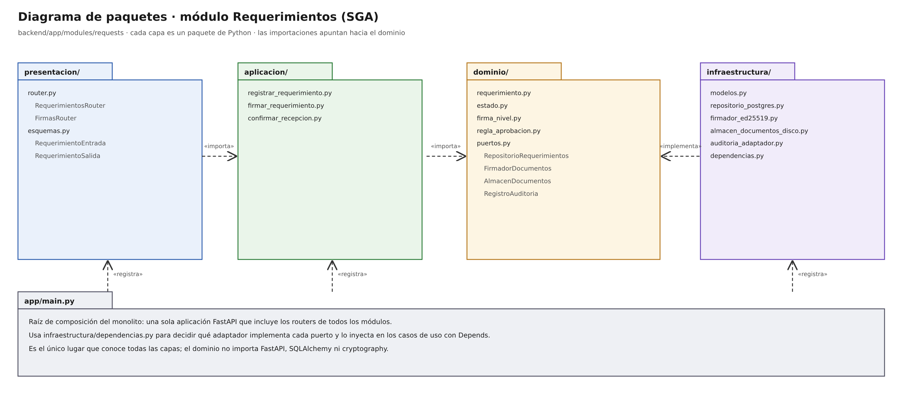
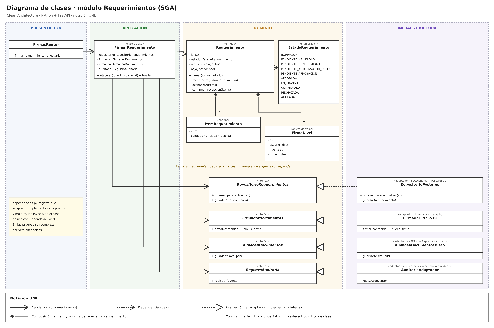
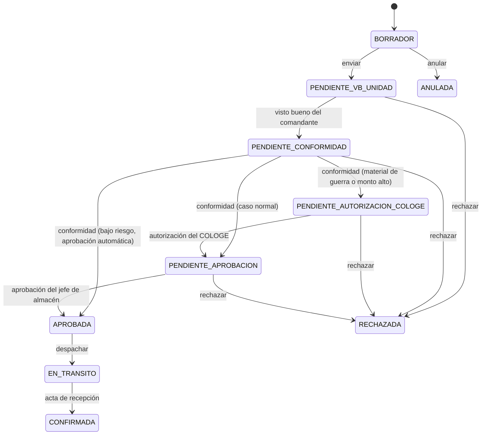
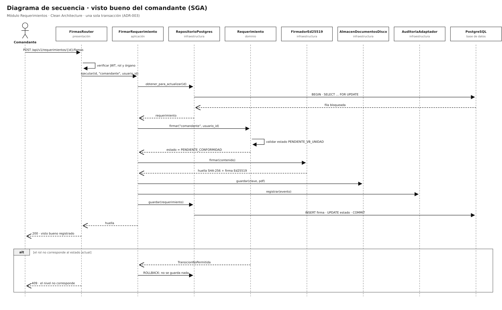

# Diseño interno de módulos

> **Proyecto:** SGA · **Backend:** Python + FastAPI · **Módulo de referencia:** Requerimientos
> **Enfoque arquitectónico:** Clean Architecture dentro de cada módulo del monolito modular
> **Nivel C4:** 4 – Código · **Versión:** 2.0

---

## 1. Propósito

Este documento describe **cómo se organiza el código dentro de un módulo** del backend. Tiene tres objetivos:

- que los ocho módulos se construyan con la misma estructura;
- que las reglas del negocio queden en el dominio, sin depender de FastAPI ni de PostgreSQL;
- que se sepa dónde va cada archivo y de qué puede depender.

Los nombres de carpetas y archivos del código se escriben en español sin tildes; las librerías externas conservan sus nombres originales.

## 2. Estructura de carpetas

```text
backend/app/
├── main.py                              Raíz de composición: crea la aplicación y registra los módulos
├── core/                                Configuración, conexión a la base de datos y seguridad (JWT)
└── modules/
    └── requests/                        Módulo Requerimientos
        ├── dominio/
        │   ├── requerimiento.py         Entidad Requerimiento y sus transiciones de estado
        │   ├── estado.py                Enumeración EstadoRequerimiento
        │   ├── firma_nivel.py           Objeto de valor FirmaNivel
        │   ├── regla_aprobacion.py      Regla: cuándo interviene el COLOGE
        │   └── puertos.py               Contratos: repositorio, firmador, almacén de documentos y auditoría
        ├── aplicacion/
        │   ├── registrar_requerimiento.py
        │   ├── firmar_requerimiento.py
        │   └── confirmar_recepcion.py
        ├── infraestructura/
        │   ├── modelos.py               Tablas con SQLAlchemy
        │   ├── repositorio_postgres.py  Implementa RepositorioRequerimientos
        │   ├── firmador_ed25519.py      Implementa FirmadorDocumentos con la librería cryptography
        │   ├── almacen_documentos_disco.py  Implementa AlmacenDocumentos y genera el PDF con ReportLab
        │   ├── auditoria_adaptador.py   Implementa RegistroAuditoria usando el módulo Auditoría
        │   └── dependencias.py          Registra qué adaptador implementa cada puerto
        └── presentacion/
            ├── router.py                Rutas /api/v1/requerimientos y /firmas
            └── esquemas.py              Validación de entrada y salida con Pydantic
```

Los demás módulos (`identity`, `catalog`, `rules`, `signing`, `inventory`, `audit`, `reports`) siguen la misma estructura.

## 3. Capas del módulo y regla de dependencia



> Archivo editable: `img/fuentes-svg/paquetes-modulo-requerimientos.svg`

| Capa | Contiene | Responsabilidad | Puede depender de | **No** puede depender de |
|---|---|---|---|---|
| **Dominio** | Entidades, estados, reglas y puertos | Reglas del negocio del conducto regular | Nada externo (Python puro) | FastAPI, SQLAlchemy, cryptography |
| **Aplicación** | Casos de uso | Coordinar los pasos de cada operación | Dominio | Infraestructura y presentación |
| **Infraestructura** | Adaptadores | Implementar los puertos con una tecnología concreta | Dominio | Presentación |
| **Presentación** | Rutas y esquemas | Traducir HTTP a casos de uso y viceversa | Aplicación | Infraestructura directamente |

### 3.1 Reglas de negocio del módulo Requerimientos

| ID | Regla de negocio | Dónde se aplica |
|---|---|---|
| RN01 | Un requerimiento solo avanza cuando firma el nivel que le corresponde según su estado. | `dominio/requerimiento.py` |
| RN02 | Ningún nivel del conducto regular puede omitirse ni firmar dos veces. | `dominio/requerimiento.py` |
| RN03 | Los requerimientos de material de guerra o de monto alto requieren la autorización del COLOGE. | `dominio/regla_aprobacion.py` |
| RN04 | Los requerimientos de bajo riesgo se aprueban automáticamente en el almacén. | `dominio/regla_aprobacion.py` |
| RN05 | Cualquier firmante puede rechazar un requerimiento, pero siempre indicando el motivo. | `dominio/requerimiento.py` |
| RN06 | Una vez despachado, el requerimiento ya no puede anularse. | `dominio/requerimiento.py` |
| RN07 | Las firmas, el despacho y la recepción se guardan en una sola transacción con su auditoría. | `aplicacion/` + `infraestructura/repositorio_postgres.py` |

## 4. Diagrama de clases



> Archivo editable: `img/fuentes-svg/clases-modulo-requerimientos.svg`

## 5. Estados del requerimiento (conducto regular)



Cualquier transición no listada es rechazada por el dominio.

## 6. Flujo de ejecución: visto bueno del comandante



> Archivo editable: `img/fuentes-svg/secuencia-firmar-requerimiento.svg`
