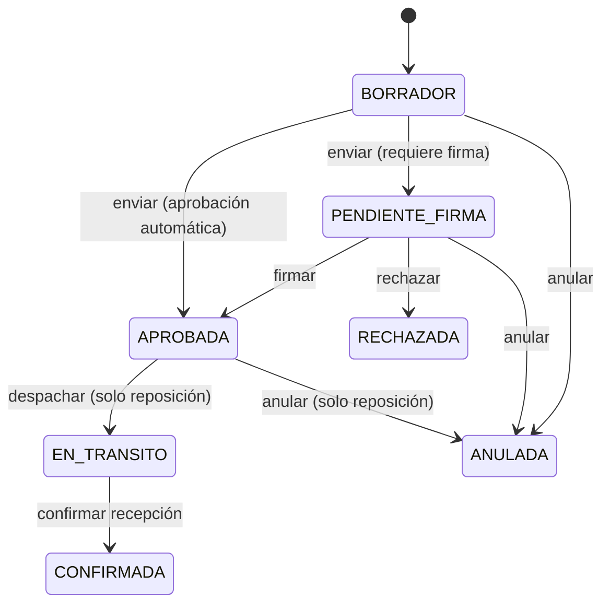

# Diseño interno de módulos

> **Proyecto:** SGA · **Backend:** Python + FastAPI · **Módulo de referencia:** Solicitudes
> **Enfoque arquitectónico:** capas dentro de cada módulo del monolito modular
> **Nivel C4:** 4 – Código · **Versión:** 1.0

---

## 1. Propósito

Este documento describe **cómo se organiza el código dentro de un módulo** del backend. Tiene tres objetivos:

- que los nueve módulos se construyan con la misma estructura;
- que las reglas del negocio queden en la capa de servicio y no en las rutas de la API;
- que se sepa dónde va cada archivo y de qué puede depender.

Los nombres de carpetas y archivos del código se escriben en inglés, como es habitual en programación.

## 2. Estructura de carpetas

```text
backend/app/
├── main.py                    Crea la aplicación y registra las rutas de cada módulo
├── core/                      Configuración, conexión a la base de datos y seguridad
└── modules/
    └── requests/              Módulo Solicitudes
        ├── api.py             Rutas de la API, validación y códigos de respuesta
        ├── service.py         Reglas: enviar, firmar, anular, calcular prioridad
        ├── repository.py      Consultas a la base de datos
        ├── models.py          Tablas: solicitudes, ítems e historial de estados
        └── schemas.py         Formato de los datos de entrada y de salida
```

Los demás módulos (`identity`, `catalog`, `rules`, `signing`, `inventory`, `messaging`, `audit`, `reports`) siguen la misma estructura.

## 3. Reglas de dependencia

| Capa | Puede usar | No puede usar |
|---|---|---|
| **API** | Esquemas, servicio del mismo módulo, utilidades de `core` | Repositorio y modelos |
| **Servicio** | Repositorio del mismo módulo, servicios de otros módulos | Repositorio o modelos de otro módulo |
| **Repositorio** | Modelos del mismo módulo | Reglas del negocio |
| **Modelos** | La librería de base de datos (SQLAlchemy) | Nada de otros módulos |

## 4. Estados de una solicitud



En una solicitud de **salida**, el estado `APROBADA` es el final. Cualquier cambio de estado no permitido es rechazado por el sistema.

## 5. Ejemplo de código por capa

> El código es una guía de la estructura; la implementación final se realizará en las siguientes iteraciones.

### 5.1 API: solo recibe la petición y responde

```python
# backend/app/modules/requests/api.py
from uuid import UUID
from fastapi import APIRouter, Depends
from sqlalchemy.orm import Session

from app.core.database import get_db
from app.core.security import CurrentUser, get_current_user
from . import service
from .schemas import RequestOut

router = APIRouter(prefix="/requests", tags=["requests"])


@router.post("/{request_id}/submit", response_model=RequestOut)
def submit_request(
    request_id: UUID,
    db: Session = Depends(get_db),
    user: CurrentUser = Depends(get_current_user),
) -> RequestOut:
    return service.submit(db, request_id, actor=user)
```

### 5.2 Servicio: aquí están las reglas del negocio

```python
# backend/app/modules/requests/service.py  (resumen)
def submit(db, request_id, actor):
    with db.begin():                                       # todo o nada
        req = repository.get_for_update(db, request_id)
        if req is None or not can_view(actor, req):
            raise NotFoundError()                          # no revela que existe
        if req.status != RequestStatus.BORRADOR:
            raise ConflictError("La solicitud ya fue enviada")

        levels = inventory_service.levels_for(db, req)     # servicio de otro módulo
        req.priority = compute_priority(req, levels)       # prioridad calculada

        decision = rules_service.evaluate(db, req)         # módulo Reglas
        if decision.auto_approve:
            approve(db, req, signer="SYSTEM")              # firma, stock y alertas
        else:
            change_status(db, req, RequestStatus.PENDIENTE_FIRMA, actor)

        audit_service.record(db, actor, "request.submit", req)
    return to_schema(req)
```

### 5.3 Repositorio: solo consultas

```python
# backend/app/modules/requests/repository.py
from sqlalchemy import select
from .models import Request


def get_for_update(db, request_id):
    stmt = select(Request).where(Request.id == request_id).with_for_update()
    return db.scalars(stmt).first()
```

`with_for_update()` bloquea la fila mientras dura la transacción. Así, dos usuarios no pueden modificar la misma solicitud al mismo tiempo.

## 6. Pruebas por capa

| Capa | Tipo de prueba | Ejemplo |
|---|---|---|
| Servicio (cálculos) | Unitaria | Una reposición con un ítem agotado obtiene prioridad crítica. |
| Servicio + repositorio | Integración con la base de datos | Enviar dos veces la misma solicitud: la segunda vez es rechazada. |
| API | Integración | Un almacenero que intenta firmar recibe un error de permiso. |