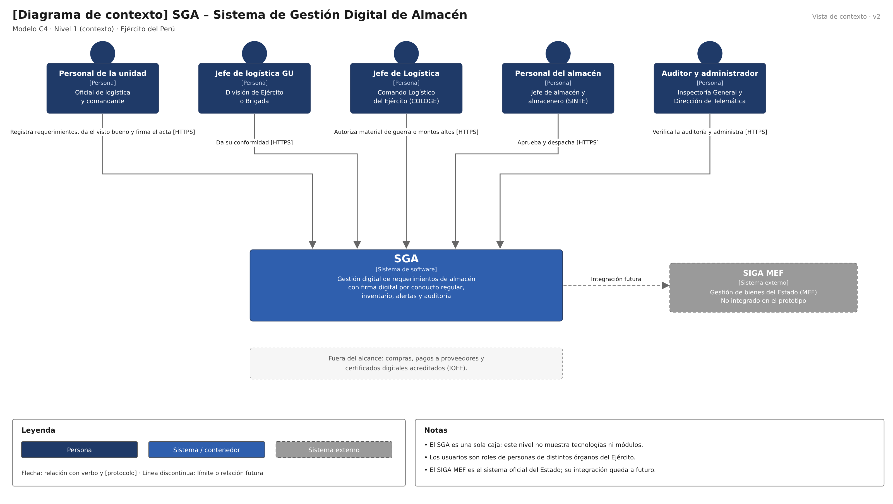

# Nivel 1 · Diagrama de contexto del sistema

> **Proyecto:** SGA
> **Modelo:** C4 · Nivel 1 de 4 · **Versión:** 2.0

---

## 1. Objetivo

Mostrar el **SGA como una sola caja**: quiénes lo usan y con qué se relaciona. Es la vista de mayor nivel y la primera que se presenta a cualquier persona, técnica o no.

| Aspecto | Descripción |
|---|---|
| Pregunta que responde | ¿Qué es el sistema, quién lo usa y con quién se relaciona? |
| Audiencia | Todos: personal logístico del Ejército, docente y equipo de desarrollo |
| Qué **no** muestra | Tecnologías, servidores, bases de datos ni módulos internos |
| Siguiente nivel | `Nivel2-DiagramadeContenedores.md` |

---

## 2. Diagrama

> Archivo editable: `img/fuentes-svg/nivel1-contexto.svg`

---

## 3. Personas (usuarios)

| Persona | Órgano | Qué hace en el sistema |
|---|---|---|
| **Oficial de logística de la unidad** | Unidad | Registra requerimientos y salidas, revisa alertas y firma el acta de recepción |
| **Comandante de la unidad** | Unidad | Da el visto bueno a los requerimientos de su unidad o los rechaza |
| **Jefe de logística de la Gran Unidad** | División de Ejército o Brigada | Da su conformidad a los requerimientos de su jurisdicción o los rechaza |
| **Jefe de Logística del COLOGE** | Comando Logístico del Ejército | Autoriza los requerimientos de material de guerra o de montos altos |
| **Jefe de almacén** | Servicio de Intendencia o de Material de Guerra | Aprueba o rechaza la atención según el stock |
| **Almacenero** | Servicio de Intendencia o de Material de Guerra | Despacha los materiales aprobados |
| **Auditor** | Inspectoría General del Ejército | Consulta la trazabilidad y verifica la integridad de los documentos |
| **Administrador** | Dirección de Telemática y Estadística | Gestiona órganos, unidades, almacenes, ítems y usuarios |

---

## 4. Sistemas

| Sistema | Tipo | Responsabilidad | Quién lo construye |
|---|---|---|---|
| **SGA** | Sistema en alcance | Gestiona requerimientos por conducto regular, firma digital, inventario, alertas y auditoría | La autora del proyecto |
| **SIGA MEF** | Sistema externo | Sistema oficial del Estado para la gestión de bienes; no se integra en el prototipo (RC12) | Ministerio de Economía y Finanzas |

---

## 5. Relaciones

| Origen | Destino | Descripción | Protocolo |
|---|---|---|---|
| Personal de la unidad | SGA | Registra requerimientos, da el visto bueno y firma el acta de recepción | HTTPS |
| Jefe de logística de la Gran Unidad | SGA | Da su conformidad | HTTPS |
| Jefe de Logística del COLOGE | SGA | Autoriza material de guerra o montos altos | HTTPS |
| Personal del almacén | SGA | Aprueba y despacha | HTTPS |
| Auditor y administrador | SGA | Verifican la auditoría y administran el sistema | HTTPS |
| SGA | SIGA MEF | Integración prevista para una versión futura | — |