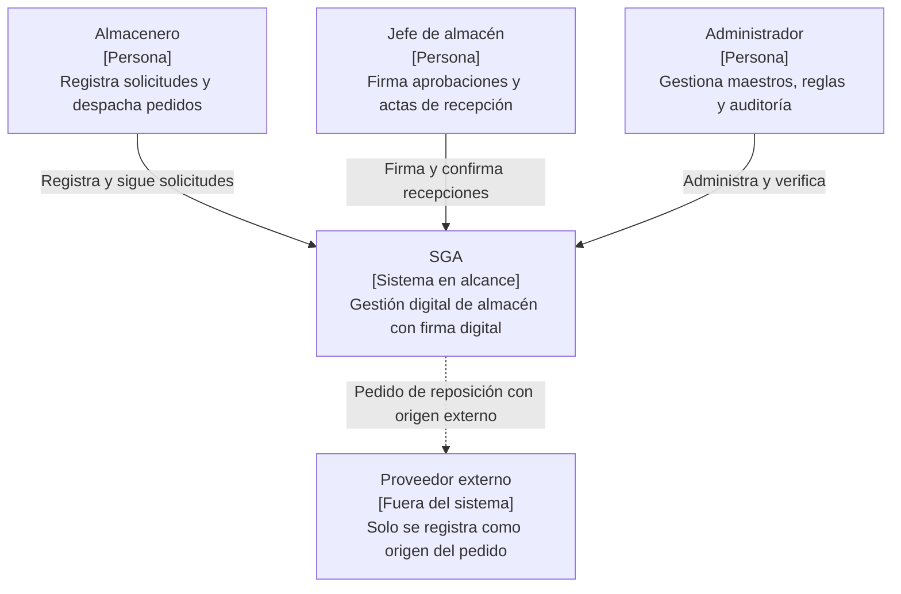

# Nivel 1 · Diagrama de contexto del sistema

> **Proyecto:** SGA
> **Modelo:** C4 · Nivel 1 de 4 · **Versión:** 1.0

---

## 1. Objetivo

Mostrar el **SGA como una sola caja**: quiénes lo usan y con qué se relaciona. Es la vista de mayor nivel y la primera que se presenta a cualquier persona, técnica o no.

| Aspecto | Descripción |
|---|---|
| Pregunta que responde | ¿Qué es el sistema, quién lo usa y con quién se relaciona? |
| Audiencia | Todos: usuarios del almacén, docente y equipo de desarrollo |
| Qué **no** muestra | Tecnologías, servidores, bases de datos ni módulos internos |
| Siguiente nivel | `Nivel2-DiagramadeContenedores.md` |

---

## 2. Diagrama

---

## 3. Personas (usuarios)

| Persona | Descripción | Qué hace en el sistema |
|---|---|---|
| **Almacenero** | Personal que trabaja en un almacén | Registra solicitudes, se comunica dentro de cada solicitud, despacha pedidos y revisa las alertas de stock |
| **Jefe de almacén** | Responsable de un almacén | Firma o rechaza solicitudes, confirma recepciones con acta firmada y configura los umbrales de stock |
| **Administrador** | Responsable del sistema | Gestiona almacenes, ítems, usuarios y reglas, y verifica la auditoría |

---

## 4. Sistemas

| Sistema | Tipo | Responsabilidad | Quién lo construye |
|---|---|---|---|
| **SGA** | Sistema en alcance | Gestiona solicitudes, firma digital, inventario, alertas, seguimiento y auditoría | La autora del proyecto |
| **Proveedor externo** | Fuera del sistema | Abastece pedidos de reposición; no tiene acceso al sistema | — |

> En esta versión el SGA no se integra con sistemas externos; las compras y los pagos a proveedores están fuera del alcance.