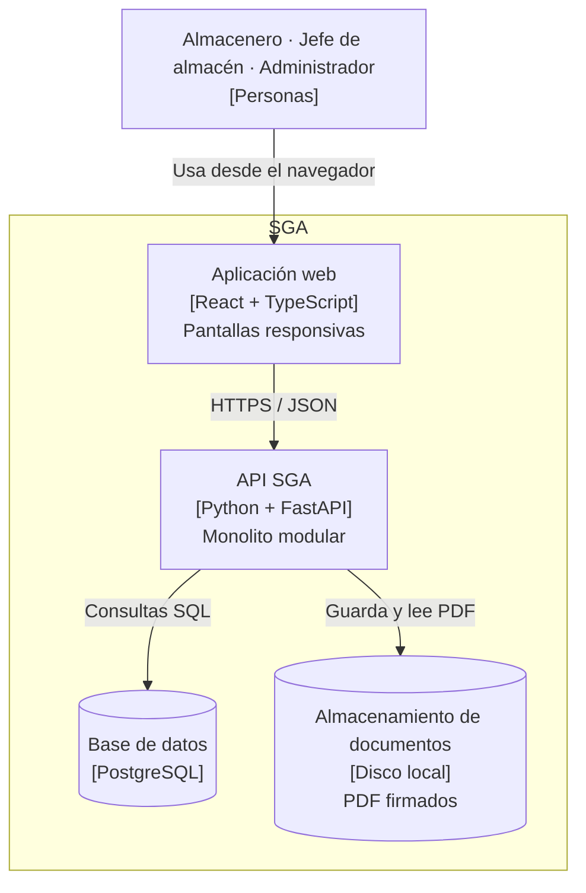

# Nivel 2 · Diagrama de contenedores

> **Proyecto:** SGA
> **Modelo:** C4 · Nivel 2 de 4 · **Versión:** 1.0

---

## 1. Objetivo

Abrir la caja «SGA» del nivel 1 y mostrar los **contenedores** que la forman: las aplicaciones y los almacenes de datos que se ejecutan por separado, la tecnología de cada uno y cómo se comunican.

| Aspecto | Descripción |
|---|---|
| Pregunta que responde | ¿De qué piezas ejecutables se compone el sistema y con qué tecnología? |
| Audiencia | Docente y equipo de desarrollo |
| Qué es un contenedor | Algo que se ejecuta o almacena datos de forma independiente: una aplicación web, una API, una base de datos (no es lo mismo que un contenedor Docker) |
| Nivel anterior | `Nivel1-DiagramadeContextodelSistema.md` |
| Siguiente nivel | `Nivel3-DiagramadeComponentes.md` |

---

## 2. Diagrama

---

## 3. Contenedores

| Contenedor | Tecnología | Responsabilidad | Datos que maneja |
|---|---|---|---|
| **Aplicación web** | React + TypeScript | Interfaz responsiva para los tres roles. Se ejecuta en el navegador | Ninguno permanente; solo el estado de la pantalla |
| **API SGA** | Python + FastAPI | Expone la API REST y aplica las reglas del negocio: aprobación, firma, inventario, alertas y auditoría. Es un **monolito modular** | Ninguno propio; usa la base de datos y el almacenamiento |
| **Base de datos** | PostgreSQL | Almacena de forma permanente la información del negocio | Usuarios, almacenes, ítems, stock, solicitudes, firmas, movimientos, mensajes y auditoría |
| **Almacenamiento de documentos** | Disco local del servidor | Guarda los PDF firmados, que no se modifican | Documentos de aprobación y actas de recepción |

---

## 4. Relaciones

| Origen | Destino | Descripción | Protocolo |
|---|---|---|---|
| Personas | Aplicación web | Usan el sistema | HTTPS |
| Aplicación web | API SGA | Envía peticiones con el token de sesión | HTTPS / JSON |
| API SGA | Base de datos | Lee y escribe información en transacciones | SQL |
| API SGA | Almacenamiento de documentos | Guarda y lee los PDF firmados | Sistema de archivos |

> Al desplegar el sistema, todos los contenedores se ejecutan con Docker Compose.