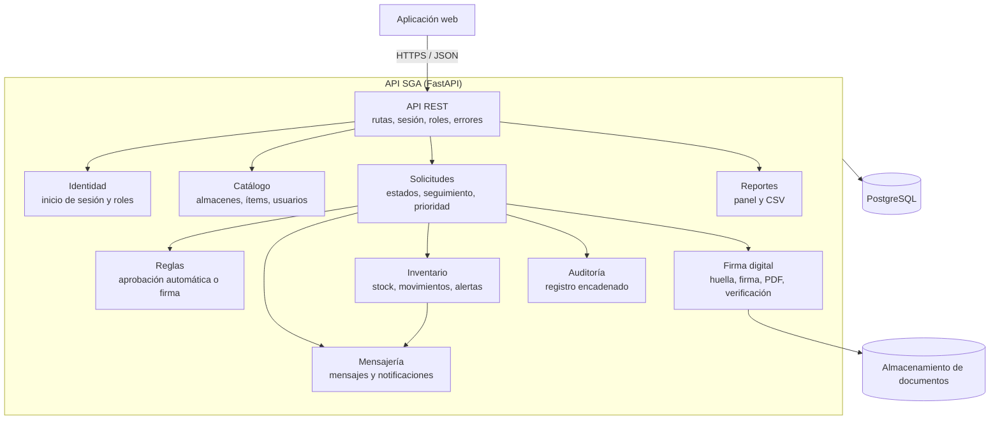

# Nivel 3 · Diagrama de componentes

> **Proyecto:** SGA · **Contenedor detallado:** API SGA
> **Modelo:** C4 · Nivel 3 de 4 · **Versión:** 1.0

---

## 1. Objetivo

Abrir el contenedor **API SGA** del nivel 2 y mostrar sus **componentes**: los módulos del monolito modular, la responsabilidad de cada uno y cómo se relacionan entre sí, con la base de datos y con el almacenamiento de documentos.

| Aspecto | Descripción |
|---|---|
| Pregunta que responde | ¿Cómo se divide el backend por dentro y qué hace cada parte? |
| Audiencia | Docente y equipo de desarrollo |
| Qué es un componente | Un grupo de funcionalidades con una responsabilidad clara, accesible mediante una interfaz. En este proyecto, cada **módulo** del monolito es un componente |
| Nivel anterior | `Nivel2-DiagramadeContenedores.md` |
| Siguiente nivel | `Nivel4-DiagramadeCodigo.md` |

---

## 2. Diagrama

---

## 3. Componentes

| Componente | Responsabilidad | Funcionalidades principales | Carpeta en el código |
|---|---|---|---|
| **API REST** | Punto de entrada HTTP del contenedor | Rutas `/api/v1`, verificación de la sesión, control de roles, manejo de errores | `backend/app/core/` |
| **Identidad** | Identidad y acceso | Inicio de sesión, roles y acceso por almacén | `backend/app/modules/identity/` |
| **Catálogo** | Datos maestros | Almacenes, ítems, usuarios e ítems habilitados por almacén | `backend/app/modules/catalog/` |
| **Solicitudes** | Ciclo de vida de las solicitudes | Registro, estados, historial, despacho, recepción, prioridad y orden de atención | `backend/app/modules/requests/` |
| **Reglas** | Decisión de aprobación | Evaluación de reglas en orden y administración de reglas | `backend/app/modules/rules/` |
| **Firma digital** | Documentos firmados | Huella SHA-256, firma Ed25519, generación del PDF y verificación | `backend/app/modules/signing/` |
| **Inventario** | Control de stock | Stock, registro de movimientos, umbrales, alertas y sugerencias de reposición | `backend/app/modules/inventory/` |
| **Mensajería** | Comunicación | Mensajes dentro de cada solicitud y notificaciones | `backend/app/modules/messaging/` |
| **Auditoría** | Trazabilidad | Registro encadenado de operaciones y verificación de la cadena | `backend/app/modules/audit/` |
| **Reportes** | Consulta de información | Panel de control y reportes exportables en CSV | `backend/app/modules/reports/` |