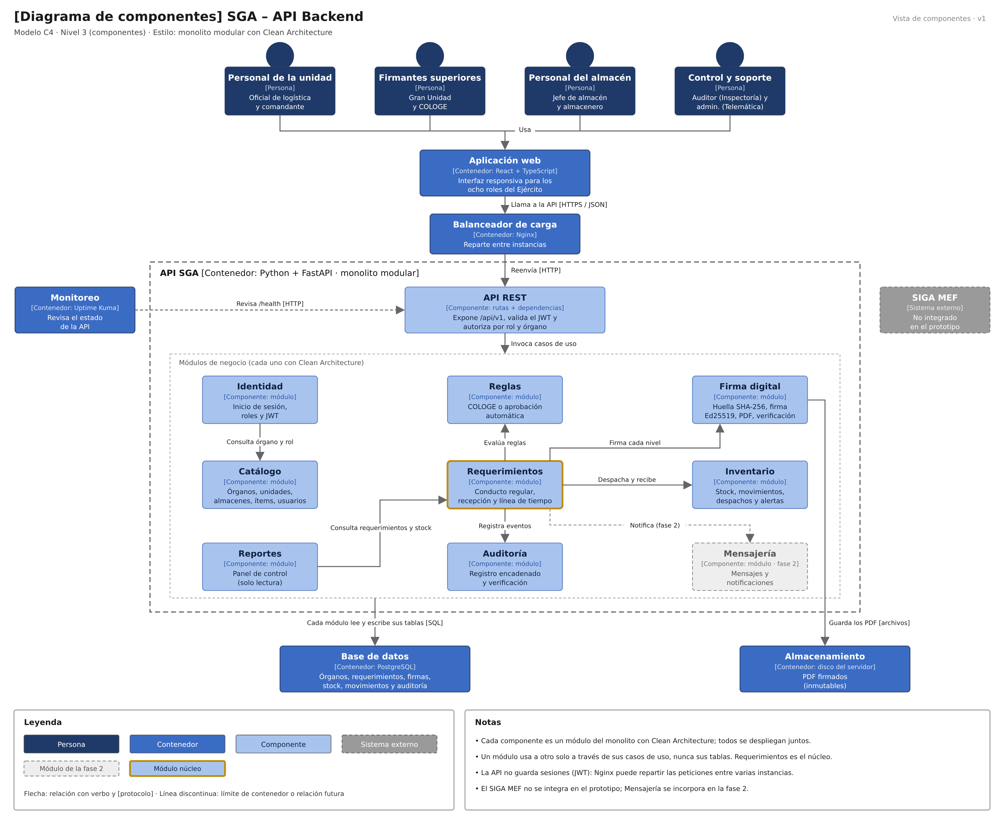

# Nivel 3 · Diagrama de componentes

> **Proyecto:** SGA · **Contenedor detallado:** API SGA
> **Modelo:** C4 · Nivel 3 de 4 · **Versión:** 2.0

---

## 1. Objetivo

Abrir el contenedor **API SGA** del nivel 2 y mostrar sus **componentes**: los módulos del monolito modular, la responsabilidad de cada uno y cómo se relacionan entre sí, con la base de datos y con el almacenamiento de documentos.

| Aspecto | Descripción |
|---|---|
| Pregunta que responde | ¿Cómo se divide el backend por dentro y qué hace cada parte? |
| Audiencia | Docente y equipo de desarrollo |
| Qué es un componente | Un grupo de funcionalidades con una responsabilidad clara, accesible mediante una interfaz. En este proyecto, cada **módulo** del monolito es un componente |
| Nivel anterior | `Nivel2-DiagramadeContenedores.md` |
| Siguiente nivel | `Nivel4-DiagramadeCodigo.md` |

---

## 2. Diagrama

> Archivo editable: `img/fuentes-svg/componentes-sga.svg`

---

## 3. Componentes

| Componente | Responsabilidad | Funcionalidades principales | Carpeta en el código |
|---|---|---|---|
| **API REST** | Punto de entrada HTTP del contenedor | Rutas `/api/v1`, verificación del JWT, control de roles y manejo de errores | `backend/app/core/` |
| **Identidad** | Identidad y acceso | Inicio de sesión, roles y acceso según el órgano | `backend/app/modules/identity/` |
| **Catálogo** | Datos maestros | Órganos con su jerarquía, unidades, almacenes, ítems y usuarios | `backend/app/modules/catalog/` |
| **Requerimientos** | Ciclo de vida del requerimiento | Registro, conducto regular, rechazos, recepción y línea de tiempo | `backend/app/modules/requests/` |
| **Reglas** | Decisión del camino de aprobación | Autorización del COLOGE para material de guerra o montos altos, y aprobación automática | `backend/app/modules/rules/` |
| **Firma digital** | Documentos firmados | Huella SHA-256, firma Ed25519, generación del PDF y verificación | `backend/app/modules/signing/` |
| **Inventario** | Control de stock | Stock, registro de movimientos, despachos, salidas y alertas | `backend/app/modules/inventory/` |
| **Auditoría** | Trazabilidad | Registro encadenado, verificación de la cadena y consulta del auditor | `backend/app/modules/audit/` |
| **Reportes** | Consulta de información | Panel de control con el estado de los requerimientos y del stock | `backend/app/modules/reports/` |
| **Mensajería** | Comunicación (fase 2) | Mensajes dentro de cada requerimiento y notificaciones | `backend/app/modules/messaging/` |

---

## 4. Reglas del monolito modular

1. Cada módulo se organiza con Clean Architecture: `dominio/`, `aplicacion/`, `infraestructura/` y `presentacion/`.
2. Un módulo usa a otro solo a través de sus casos de uso, nunca sus tablas.
3. **Requerimientos** es el módulo núcleo: coordina Reglas, Firma digital, Inventario y Auditoría.