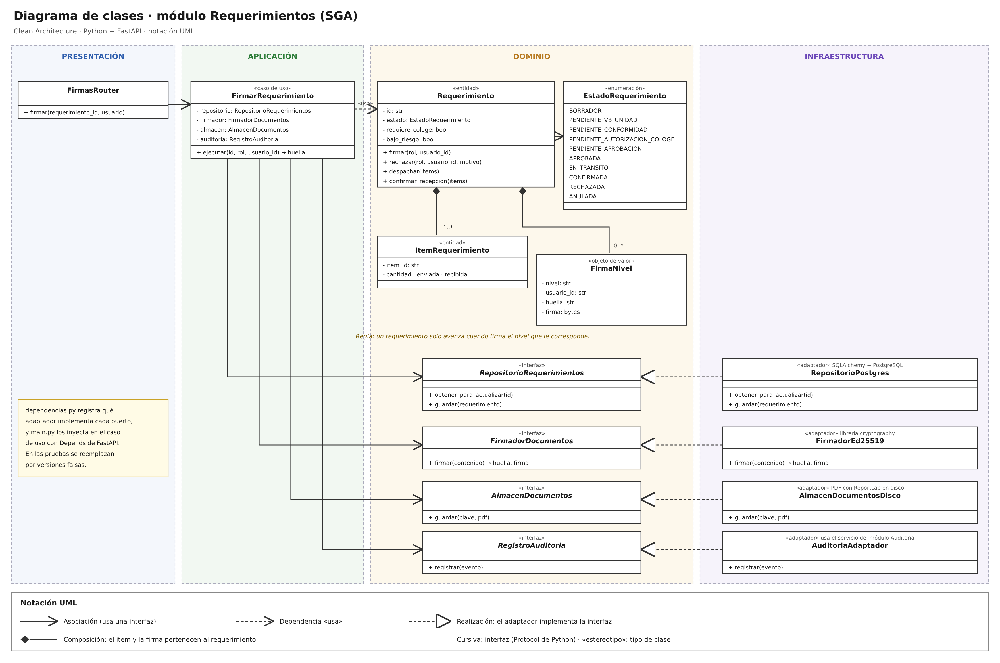
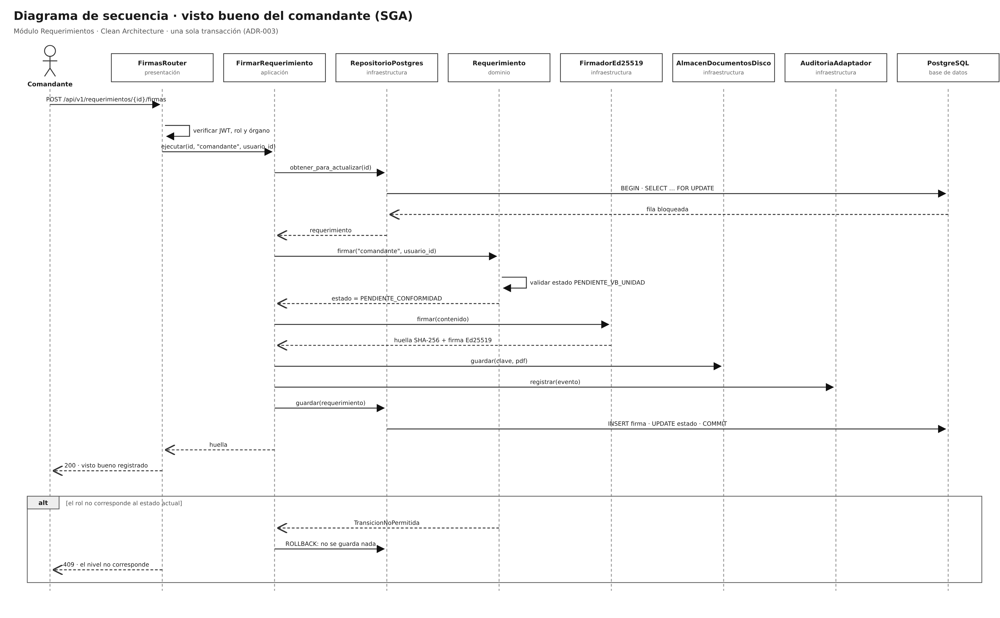

# Nivel 4 · Diagrama de código

> **Proyecto:** SGA · **Componentes detallados:** Requerimientos y Firma digital
> **Modelo:** C4 · Nivel 4 de 4 · **Versión:** 2.0

---

## 1. Objetivo

Mostrar las **clases principales** del módulo Requerimientos y su relación con la firma digital, y cómo colaboran cuando un nivel del conducto regular firma un requerimiento.

| Aspecto | Descripción |
|---|---|
| Pregunta que responde | ¿Qué clases existen dentro de un módulo y cómo se relacionan? |
| Audiencia | Equipo de desarrollo |
| Notación | UML (diagrama de clases y diagrama de secuencia). El modelo C4 recomienda UML para este nivel |
| Por qué solo estos módulos | El nivel 4 es opcional en C4 y se dibuja solo para los componentes más importantes. Requerimientos y Firma digital concentran las reglas más críticas del sistema |
| Nivel anterior | `Nivel3-DiagramadeComponentes.md` |

---

## 2. Diagrama de clases

> Archivo editable: `img/fuentes-svg/clases-modulo-requerimientos.svg`

### 2.1 Capas de Clean Architecture

| Capa | Clases | Regla |
|---|---|---|
| **Presentación** | `FirmasRouter` | Traduce la petición HTTP en una llamada al caso de uso |
| **Aplicación** | `FirmarRequerimiento` | Coordina los pasos de la firma usando solo los puertos |
| **Dominio** | `Requerimiento`, `ItemRequerimiento`, `FirmaNivel`, `EstadoRequerimiento` y los puertos | Contiene las reglas del conducto regular; no importa ninguna librería externa |
| **Infraestructura** | `RepositorioPostgres`, `FirmadorEd25519`, `AlmacenDocumentosDisco`, `AuditoriaAdaptador` | Implementan los puertos con PostgreSQL, la librería `cryptography` y el disco |

> **Regla de dependencia:** las flechas del código apuntan hacia el dominio; los adaptadores implementan los puertos que define el dominio.

---

## 3. Diagrama de secuencia: visto bueno del comandante

> Archivo editable: `img/fuentes-svg/secuencia-firmar-requerimiento.svg`

Si cualquier paso falla, la transacción se cancela y no se guarda ningún cambio (ADR-003). Si el comandante intenta firmar en un estado que no le corresponde, la entidad `Requerimiento` lanza `TransicionNoPermitida` y la API responde 409.

---

## 4. Patrones y principios que se ven en este nivel

| Elemento del diagrama | Patrón o principio |
|---|---|
| `RepositorioRequerimientos` y `RepositorioPostgres` | Repository · Inversión de dependencias |
| `FirmadorDocumentos` y `FirmadorEd25519` | Adapter · Sustitución de Liskov |
| `EstadoRequerimiento` y `Requerimiento.firmar()` | State |
| Transacción con bloqueo del requerimiento | Unit of Work |
| `main.py` y `dependencias.py` | Dependency Injection |