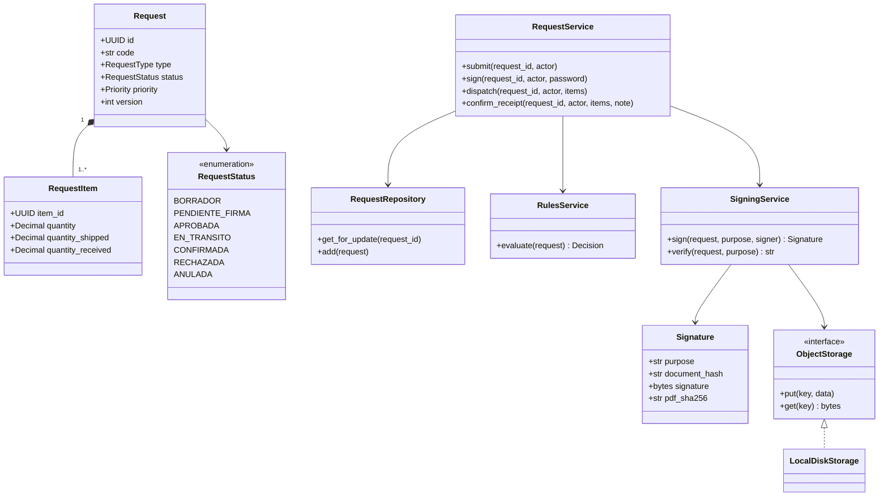
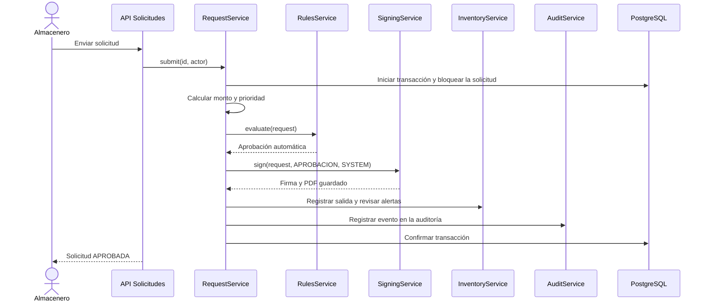

# Nivel 4 · Diagrama de código

> **Proyecto:** SGA · **Componentes detallados:** Solicitudes y Firma digital
> **Modelo:** C4 · Nivel 4 de 4 · **Versión:** 1.0

---

## 1. Objetivo

Mostrar las **clases principales** de los módulos Solicitudes y Firma digital, y cómo colaboran cuando se aprueba una solicitud.

| Aspecto | Descripción |
|---|---|
| Pregunta que responde | ¿Qué clases existen dentro de un módulo y cómo se relacionan? |
| Audiencia | Equipo de desarrollo |
| Notación | UML (diagrama de clases y diagrama de secuencia). El modelo C4 recomienda UML para este nivel |
| Por qué solo dos módulos | El nivel 4 es opcional en C4 y se dibuja solo para los componentes más importantes. Solicitudes y Firma digital concentran las reglas más críticas del sistema |
| Nivel anterior | `Nivel3-DiagramadeComponentes.md` |

---

## 2. Diagrama de clases

### 2.1 Capas representadas

| Capa | Clases | Regla |
|---|---|---|
| **Modelos** | `Request`, `RequestItem`, `Signature` | Representan los datos guardados en la base de datos |
| **Servicio** | `RequestService`, `RulesService`, `SigningService` | Contienen las reglas del negocio |
| **Repositorio** | `RequestRepository` | Realiza las consultas a la base de datos |
| **Interfaz y adaptador** | `ObjectStorage`, `LocalDiskStorage` | El servicio de firma depende de la interfaz, no del disco |

---

## 3. Diagrama de secuencia: salida aprobada automáticamente

> Si cualquier paso falla, la transacción se cancela y no se guarda ningún cambio.